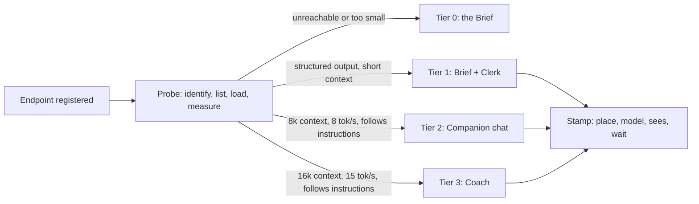

# The coach, local first

A design for how LifeOS should use a language model for coaching when the model might be a 27B running on a four-GPU desktop, a 4B on a Mac Mini, a 2B on a VPS with no GPU, a hosted model someone pays for, or nothing at all. Written against branch `v2` on 7 November 2026. Nothing in this document is implemented; the snippets are illustrative and the probe was not run against real hardware, because the sandbox this was written in cannot reach any inference host.

## The design in a page

LifeOS stops assuming a model. It discovers one, measures it, and puts the coach page to work at whatever level the measurement supports. The person is told, before every message, where their words are about to go and roughly how long the answer will take. The journal stays out of the coach's sight at every level, local or remote, and the only bridge across that wall is one entry at a time, carried over by hand.

On first run, the coach page does not show a chat box. It shows the Brief: a reading of today, this week and this quarter assembled from the records the app already keeps, with a line at the top saying "No model is connected. Everything on this sheet comes from your own entries; nothing is inferred." Underneath is a single action, "Connect a model", which goes to a settings sheet. The Brief is a complete feature. An install that never connects a model keeps it forever and loses nothing it was promised.

When an endpoint is added (the deploy's `LIFEOS_LLM_BASE_URL` seeds one automatically), the app probes it within a few seconds: what is it, what models does it hold, how large a prompt does the loaded model actually accept, how fast does it generate, can it return structured output, can it follow three plain instructions at once. From those measurements it assigns a tier, and the coach page changes shape to match.

At the lowest working tier the page is still the Brief, with a Clerk attached: a small model that reads text already on the screen and does bounded jobs to it. It drafts the week's review from seven days of check-ins, files each morning priority against the quest it serves, and suggests a title for a confidence entry pasted in without one. It never opens a conversation, because a small model in open conversation is the thing that gives local AI a bad name. In the middle tier the chat box appears, with short replies and a short memory, and the page says so. At the top tier the coach can hold a long thread, read the patterns the Insights page derives, draft a weekly review in dialogue, and, only when inference is on a machine in the house, be handed a single journal entry for the length of one conversation.

Above the composer, always, is a stamp. It names the place ("Framestation, this house" or "OpenRouter, remote"), the model, what the coach can see, and the measured wait. When the place is remote the stamp changes stock and the first send of each profile requires a deliberate acknowledgement. Five people share the install; which model each uses, whether they have agreed to remote inference, and any hosted credential they connected are theirs alone.



## What exists today

`lib/coach/context.ts` assembles one object: identity statement, today's morning and evening check-in, active quests, the seven-day scorecard, the latest balance reading, the last five confidence entries, and the quarter position. `lib/coach/system-prompt.ts` turns that into roughly 1,200 tokens of system prompt with a privacy paragraph that names what the coach can and cannot see. `app/api/coach/chat/route.ts` posts it with the conversation to one OpenAI-compatible `chat/completions` URL from env, streams the result back untouched, and returns a 502 when the fetch fails. `components/coach/CoachChat.tsx` renders the stream, strips `<think>` blocks, and shows the 502 as an alert. `app/coach/page.tsx` prints the model name and host from env in the corner. Conversation history lives in React state and dies with the tab.

The journal wall is enforced by convention and comment: `context.ts` says never to import the journal or open-loop schemas, the journal schema file lists the modules that must not read it, and the Collection reads nothing from it. One small inconsistency worth knowing about: `lib/insights/queries.ts` does import `lifeosJournalEntries`, for a decision count only, and `patterns.ts` prints that count. Content never crosses; a number does. This design keeps the number and nothing more.

## The capability probe

The probe answers five questions about an endpoint, in order of cost: is it there, what is it, what models does it hold, what can the chosen model do, and how fast. Each step is a stored fact with a timestamp, and later steps are skipped when earlier ones fail.

### Step 1, identify

Three requests, two seconds each, in parallel: `GET {base}/api/tags` (Ollama's native list, also served by llama.cpp's `llama-server`), `GET {base}/props` (llama.cpp only), and `GET {base}/v1/models` (any OpenAI-compatible server). The base URL stored is the server root, with `/v1` stripped if the person pasted it. The outcome is a `kind`: `ollama` when `/api/tags` answers and `/props` does not, `llamacpp` when `/props` answers, `openai` when only `/v1/models` answers, and `openrouter` when the host is `openrouter.ai`. Kind decides which API the coach speaks afterwards. For Ollama the native `/api/chat` is preferred over `/v1/chat/completions` because Ollama's OpenAI layer [cannot set the context size per request](https://docs.ollama.com/api/openai-compatibility.md), while the native endpoint accepts `num_ctx`, `keep_alive`, `think`, a `format` schema, and returns `prompt_eval_count`, `eval_count` and the durations needed for the speed stamp ([chat API](https://docs.ollama.com/api/chat.md)).

Locality is decided from the resolved address, never from the vendor. Loopback, RFC 1918, link-local, IPv6 ULA and the CGNAT range Tailscale uses (100.64/10) are `house`. Anything else is `remote`. A `.local` or bare hostname resolves before classification. This matters because an Ollama server is unauthenticated by default and Cisco found [1,139 of them reachable from the open internet](https://blogs.cisco.com/security/detecting-exposed-llm-servers-shodan-case-study-on-ollama) in September 2025. "Local" in this design means "on a machine this household controls", and the address is the only evidence the app has for that.

### Step 2, list and describe

For Ollama, `POST /api/show` per model returns `capabilities` (`completion`, `tools`, `thinking`, `vision`, `embedding`), `details.parameter_size` and `quantization_level`, and `model_info.<arch>.context_length`, the trained maximum ([show API](https://docs.ollama.com/api-reference/show-model-details.md)). For llama.cpp, `/props` gives `default_generation_settings.n_ctx`, the loaded window, and `chat_template_caps`, which says whether the template supports tools; `/v1/models` adds `n_ctx_train`, `n_params` and file size ([endpoint tour](https://mvysny.github.io/llama-server-endpoints/)). For a bare OpenAI-compatible server only the model ids are known, and everything else must be measured.

Stored per model: id, digest where the server gives one, parameter size, quantisation, declared capabilities, trained context, and the server's loaded context if it reports one.

### Step 3, warm up and measure

This step costs real inference, so it runs only for the model a profile has chosen (or the single model present), at most once a day unless asked, and only when a person is on the coach or settings page so the wait is visible and explained.

The warmup is a 40-token prompt asking for a one-sentence reply. From it: `load_ms` (Ollama's `load_duration`, or wall time to first token minus the prompt time on other servers), `prompt_tps` (`prompt_eval_count / prompt_eval_duration`), and `eval_tps` (`eval_count / eval_duration`, or streamed chunk count over wall time where the server reports no counts). After the warmup, `GET /api/ps` on Ollama returns `context_length` for the model as loaded and `size_vram` ([ps API](https://docs.ollama.com/api/ps.md)); this is the number that matters, and it is often far below the trained maximum. Older Ollama defaulted to 2,048 tokens, newer versions to 4,096 and up [depending on VRAM](https://fast.io/resources/ollama-context-length.md), and Open WebUI's own docs warn that a 2,048 window [silently truncates prompts](https://docs.openwebui.com/getting-started/quick-start/connect-a-provider/starting-with-ollama) into blank replies.

Then the canary. Truncation on Ollama is silent on every endpoint: whole leading messages are dropped first, and if that is not enough the engine keeps the first five tokens and the tail, discarding the system prompt, with [no indication in the response](https://particula.tech/blog/ollama-num-ctx-silent-prompt-truncation). So the probe measures the usable window directly. It builds a prompt of N tokens of filler with a random eight-character code planted about 100 tokens in and asks the model to repeat the code. If the code comes back, N fits. It tries 2k, 4k, 8k, 16k and 32k, stopping at the first failure or at the server's reported window, and records `ctx_usable` as the last size that passed. On Ollama the native request is sent with `shift: false`, which turns an oversized prompt into a 400 instead of a trim, and that error is itself the answer. Five short generations cost a few seconds on a fast box and under a minute on a slow one; the settings sheet shows the progress.

Structured output is tested twice: once with a JSON schema in `response_format` (or Ollama's `format`), once with a plain prompt asking for JSON and nothing else. Each result is parsed and validated. `json_schema` and `json_prompt` are recorded separately because a model that only manages the second is still a usable Clerk.

Instruction following is the crudest measurement and the one that decides whether conversation is offered at all. The prompt gives two facts and asks for a reply under 60 words that mentions both and ends with exactly one question. Scoring is mechanical: word count, both facts present as substrings, exactly one question mark at the end. Three of three is a pass. This does not measure warmth or insight; it measures whether the model can be steered by a system prompt, which is the floor beneath any coaching voice.

### What is stored

Illustrative shape, two tables, both household-level because they describe machines rather than people.

```ts
type CoachEndpoint = {
  id: string;
  label: string;              // "Framestation", "Mac Mini", "OpenRouter"
  baseUrl: string;            // server root, no /v1
  kind: "ollama" | "llamacpp" | "openai" | "openrouter";
  locality: "house" | "remote";
  lastSeenAt: Date | null;
  lastProbeAt: Date | null;
  lastError: string | null;
};

type CoachModelProbe = {
  endpointId: string;
  model: string;
  digest: string | null;
  parameterSize: string | null;   // "27B", from the server, informational
  quantization: string | null;
  capabilities: string[];         // as declared
  ctxTrained: number | null;
  ctxLoaded: number | null;       // /api/ps or /props
  ctxUsable: number | null;       // canary
  loadMs: number | null;
  promptTps: number | null;
  evalTps: number | null;
  jsonSchema: boolean | null;
  jsonPrompt: boolean | null;
  instructionScore: 0 | 1 | 2 | 3 | null;
  thinking: boolean;              // emits reasoning tokens by default
  tier: 0 | 1 | 2 | 3;
  probedAt: Date;
  staleAfter: Date;
};
```

### When it re-runs

Cheap identification (steps 1 and 2) runs on every coach page open if the last run is more than an hour old, in the background, with the previous result shown meanwhile. The expensive measurement (step 3) runs when an endpoint is first added, when a profile picks a model that has never been measured, when the stored digest no longer matches what `/api/tags` reports, when a chat request fails with a model-not-found or context error, when `staleAfter` has passed (24 hours), and when a person presses "Measure again" in settings. Measurement never runs on a schedule with nobody watching; a model that takes thirty seconds to load should load because someone wanted it.

### When it fails

An endpoint that does not answer step 1 within two seconds is marked unseen, and the coach page falls to Tier 0 immediately with a line that says which machine is not answering. There is no 502 and no alert box; the Brief is the error state, and it is a good one.

A model that was measured and has since been swapped (different digest, or missing from the list) drops to "unverified": the page runs at Tier 1 behaviour with the stamp reading "the model on Framestation changed since it was last measured", and remeasures on the next visit to settings or on the next send, whichever comes first. A plain OpenAI server with no digests is treated as unchanged until a request fails, then remeasured.

A measurement that fails halfway (the canary times out at 16k, say) keeps the partial facts and records the last size that passed. A model whose warmup never returns within 60 seconds is recorded with `evalTps: null` and placed in Tier 0 with the reason shown; a model that cannot answer a one-sentence prompt in a minute is not a coach on that hardware, whatever its parameter count.

## Tiers

The tiers are defined by what was measured, with parameter size kept as a label and never as a gate. The owner's prior was that small models are good at extraction, classification and summarisation of text in front of them and poor at open-ended reflective conversation. The research supports the first half and gives a sharper shape to the second. The VRAM-tier comparison that tracks this most carefully says that below the 27B class local models "struggle with long, complex, multi-constraint instructions" and that the 8 GB tier is suited to "everyday questions, brainstorming, simple tasks" and weak at "long multi-step reasoning" ([VRAM tier comparison](https://intelligibberish.pages.dev/articles/2026-03-17-best-local-chat-models-2026-vram-tier-comparison)); those are the author's assessments, with benchmark figures only for a few models. A coaching reply is a multi-constraint instruction: stay in voice, use these six facts, do not invent, ask one question, keep it short. So the prior holds, with one refinement: when a small model fails in conversation, the usual symptom is that it stops obeying the system prompt, and the prose itself may read fine. That symptom is exactly what the instruction probe tests.

| Tier | Name | Measured gate | What the coach page is |
|---|---|---|---|
| 0 | The Brief | No endpoint, or `ctxUsable` under 2,048, or `evalTps` under 2, or warmup failed | A reading of today, the week and the quarter from stored records. No inference. |
| 1 | Brief and Clerk | `ctxUsable` at least 2,048 and (`jsonSchema` or `jsonPrompt`) and `evalTps` at least 2 | The Brief, plus bounded jobs on text already present: review draft, priority filing, title extraction, lesson tagging. No chat. |
| 2 | Companion | `ctxUsable` at least 8,192, `evalTps` at least 8, `instructionScore` 3 | Chat with the base context, replies capped at about 250 tokens, history summarised past six turns. No journal handoff. |
| 3 | Coach | `ctxUsable` at least 16,384, `evalTps` at least 15, `instructionScore` 3 | Full thread within the budget, patterns block included, weekly review in dialogue, per-entry journal handoff when `locality` is `house`. |

A person can cap their own tier downward in settings (someone may want the Clerk and nothing more). Nobody can raise it above what was measured.

Where this lands on the hardware named in the brief, as estimates and not measurements: the Framestation's 96 GB across four cards will hold a 27B dense model at Q4 with a 32k window and room to spare, and a 70B dense or gpt-oss-120b at Q4, which is Tier 3 by any reasonable throughput. The M2 Mac Mini depends on its memory; with 16 GB, a 4B to 9B model at Q4 sits in Tier 1 or Tier 2 depending on the measured speed, and I would expect the instruction probe to be the deciding gate. A VPS with four vCPUs and no GPU will run a 1.7B to 4B model at a few tokens a second and land in Tier 1, which is where the Clerk earns its place. These are the cases the thresholds were chosen to separate; the thresholds themselves should be tuned on the owner's machines before they ship, and the 16k gate for Tier 3 is the one I am least sure of (see open questions).

Concrete model names, as of the sources read for this document and not independently verified: the 8 GB class is recommended to run Qwen3.5-9B or Gemma 4 E4B; the 16 GB class gpt-oss-20b, which [OpenAI says runs in 16 GB](https://huggingface.co/blog/daya-shankar/open-source-llm-models-to-run-locally) (a vendor claim); the 24 GB class Qwen3.6-27B dense or Gemma 4 26B-A4B; the 32 GB class GLM-4.7-Flash or Qwen3.6-35B-A3B ([tier comparison](https://intelligibberish.pages.dev/articles/2026-03-17-best-local-chat-models-2026-vram-tier-comparison)). The Hugging Face survey from May 2026 names Gemma 3 27B as "best quality on one consumer GPU" and Phi-4-mini as the most accessible small model, again as author assessment. I did not find a benchmark that isolates reflective-conversation quality by size, and the design does not pretend to; it measures what can be measured and gates on that.

### What the Clerk does

The Clerk is the answer to "what is the lowest tier, if it is not a worse chatbot". Each job is a single request with a schema, text supplied by the app, and an output the person edits before anything is saved. Nothing the Clerk produces is written to a table without a tap.

Weekly review draft. Input: the last seven days of check-ins (wins, lessons, tomorrow seeds, moods, ratings), about 1,600 tokens. Output: three candidate "what went well" lines, two "what to change" lines, each tied to the day it came from. The person edits and keeps or discards. This is summarisation of text in front of the model, and a 4B model does it acceptably; the person's own words are quoted, so the model has little room to invent.

Priority filing. Input: this morning's three priorities and the active quest titles. Output: for each priority, the quest it most plausibly serves, or "none". Shown as a chip under each priority on Today, dismissable. Classification over a dozen labels.

Confidence title. Input: a pasted body with no title. Output: a title under eight words. Extraction.

Lesson tagging. Input: tonight's "lesson" line and the six balance dimensions. Output: one dimension. Feeds a count the weekly review can show ("four of this week's lessons were about Work"). Classification.

Brief summary. Input: the Brief's own numbers and quoted lines. Output: a three-sentence paragraph in plain words, placed at the top of the Brief with the label "Summarised by the Clerk on this machine". A person who finds it unhelpful turns it off and the Brief is unchanged.

Every Clerk request sets `think: false` on Ollama (or `reasoning_effort: "low"` elsewhere) because a reasoning trace on a 3B model triples the wait for no gain in a classification task, and uses `format` with a schema when `jsonSchema` passed, otherwise the prompt-only JSON path with a parser that tolerates fences.

## The context budget

The prompt is built from blocks in priority order. Each block has a full form and, where sensible, a summary form. The fitter takes the usable window, reserves a reply allowance (a quarter of the window, capped at 1,024 tokens), and fills from the top. If the total exceeds the budget it summarises from the bottom up, then drops from the bottom up. Three blocks are required and are never dropped: the rules (voice and privacy boundary, about 180 tokens), the date and quarter line, and the latest user message. If those three do not fit, the request is refused with a visible reason instead of being sent to be silently truncated.

| Priority | Block | Full form | Summary form |
|---|---|---|---|
| 1 | Rules: voice, boundary, reply shape | ~180 tokens | none, required |
| 2 | Today: date, quarter day and phase | ~40 | none, required |
| 3 | Latest user message | as written, up to 8,000 chars | none, required |
| 4 | Morning check-in | priorities, protect, gratitude quoted | "done, energy 4, mood steady" |
| 5 | Evening check-in | win, lesson, seed quoted | "done, rated 4" |
| 6 | Active quests | every quest with domain and progress | top three by recency, plus a count |
| 7 | Seven-day scorecard | all lines | mornings, evenings, habit percent |
| 8 | Balance | six dimensions | the lowest two |
| 9 | Identity statement | quoted | dropped (no shorter form) |
| 10 | Confidence file | five entries with bodies | two titles |
| 11 | Older conversation turns | verbatim | a running summary the model wrote last turn, under 300 tokens |
| 12 | Patterns (Tier 3 only) | the Insights callouts | the first one |

Token counts are estimated at four characters per token for the first build. The estimate is corrected after every send on Ollama and llama.cpp, which both report the prompt token count; the ratio of reported to estimated is stored per model and applied next time. On a bare OpenAI server, `usage.prompt_tokens` serves the same purpose when present.

A throwaway script under `/tmp` ran this fitter against the current context shape with six quests, five confidence entries, a 400-token user message and 1,800 tokens of history. At a 2,048 window the fitter kept everything required plus the morning, evening and quests at full, took the scorecard, balance, confidence, history and patterns in summary form, and landed at 1,488 of a 1,536 budget. At 4,096 only history and patterns were summarised. At 8,192 and above everything fit at full and the window was mostly empty, which is the point: today's context is about 1,200 tokens, and the budget's real job is history and the optional enrichments. At a pathological 1,024 window it kept the three required blocks, summarised the check-ins and dropped the rest, and still fit. The same script's tier function placed a hypothetical large model loaded with a 2,048 window in Tier 1, which is the correct and slightly embarrassing answer for a misconfigured Ollama, and the stamp would say why.

The history summary deserves a note. At Tier 2 and above, once a conversation passes six turns, the previous reply's request also asks the model to append a one-paragraph summary of the conversation so far inside a delimited block the UI strips; that paragraph becomes block 11 on the next send. The summary is written by the same model that will read it, in the same place, so nothing new crosses any boundary.

## The surface without a model

The Brief is three sheets on the coach page, each composed entirely from queries the app already runs.

Today. The morning's priorities, each with the Clerk's quest chip if present. The protect line. Habits due today not yet pressed, by name. Focus minutes so far. If the evening is done, the win and the seed. If the morning is not done, the sheet says so and offers it.

The week. The scorecard sentences from `patterns.ts`, which already speak in the house voice ("7 of 7 days had half an hour or more of focus. A practice is forming."). The most consistent habit and the one most often missed, by cadence-honest tally. Average evening rating with its tone line. Morning and evening counts.

The quarter. Day N of M and the phase. Each quest with its progress against the quarter's elapsed fraction, labelled ahead, level or behind by a plain comparison (progress percent minus elapsed percent, with a five-point dead band for "level"). Quests untouched for fourteen days, named.

The five suggested openers that currently seed the chat become five chips on the Brief. Four of them have deterministic answers and expanding the chip scrolls to the matching sheet. The fifth, "I'm stuck on something. Can I think out loud?", has no answer without a model, and the chip says so honestly and offers the journal with today's lens and the protocols instead. That is a better answer than a chat box that errors.

When an endpoint exists but is not answering, the Brief carries one line at the top: "Framestation is not answering. This brief is from your own records." When no endpoint was ever configured, the line is the first-run one. In both cases the page is complete and nothing spins.

## Multi-profile

The hardware is shared; the choices are not. Endpoints and probe results are household-level, because a fact about a machine is the same fact for everyone. Everything that expresses a preference or a permission is keyed by user id.

```ts
type CoachProfileSettings = {
  userId: string;
  endpointId: string | null;      // null means the Brief, by choice
  model: string | null;
  tierCap: 0 | 1 | 2 | 3;          // downward only
  clerkSummary: boolean;
  remoteConsentAt: Date | null;    // when this person acknowledged remote inference
  remoteConsentText: string;       // the exact wording they saw
  speakAloud: boolean;
};
```

The coach route resolves the profile from the signed cookie exactly as every other route does, loads that profile's settings, and refuses a request for an endpoint the profile has not chosen. A remote connection (next section) is a row owned by one user id, and the route never looks up a connection by anything but the current profile.

One honest weakness. The profile cookie is a household-code gate plus a picker; anyone who knows the code can pick any profile. That is fine for check-ins among five people who trust each other and less fine for a credential that spends money or a consent that sends text off the premises. The design therefore requires a per-profile PIN to be set before a remote connection can be added or the tier raised above 1 on a remote endpoint. The PIN is hashed and stored on the settings row, asked for once per device per month like the household code. Whether that is enough, or whether remote inference should simply require a real signed-in session via the existing magic-link path, is an open question for the owner.

## Speed, stated

The stamp above the composer carries four facts, and the fourth is a time. The estimate is arithmetic over stored measurements:

```
wait ≈ (model loaded ? 0 : loadMs)
     + promptTokens / promptTps
     + expectedReplyTokens / evalTps
```

`promptTokens` comes from the fitter, `expectedReplyTokens` from the tier's reply cap, and "loaded" from `/api/ps` on Ollama (the `expires_at` field says how long it will stay loaded) or from a recent successful send elsewhere. The stamp rounds to a friendly unit: "about 3 seconds", "about 20 seconds", "around a minute". When the model is unloaded the stamp says so: "Waking the model on Framestation adds about 8 seconds the first time." When the measurements are older than a day the stamp says "last measured yesterday" and the estimate is shown as a range.

During generation the placeholder stops saying "The coach is thinking" and shows the place and a countdown that corrects itself on the first token: "Framestation, first words in about 4 seconds", then "writing". If the first token has not arrived at twice the estimate, the line changes to "slower than expected; Framestation may be busy" and offers two chips: wait, or switch to the Clerk's summary for this question. Ollama queues requests beyond `OLLAMA_NUM_PARALLEL`, so with five people on one box this will happen, and the stamp should never pretend otherwise.

Replies at Tier 2 are capped at about 250 tokens, so on a Mac Mini doing 12 tokens a second a reply arrives in about twenty seconds; the stamp says twenty seconds. On a VPS the Clerk's jobs are the only inference, and each is a short structured output, so the stamp on a Clerk button reads "about 15 seconds on this server" and the button shows progress instead of a spinner. Nothing in the interface says "thinking" without saying where and for how long.

## The OAuth option

The brief asked for a path to a hosted model that does not involve pasting an API key, and reasoned that a device or authorization-code flow suits a self-hosted app with no fixed callback host. The research narrows the field more than I expected, and the honest finding comes first.

Anthropic's terms, revised in February 2026, say OAuth tokens from Claude Free, Pro or Max accounts may be used [only in Claude Code and Claude.ai](https://www.theregister.com/2026/02/20/anthropic_clarifies_ban_third_party_claude_access), and the sanctioned path for other software is an API key. OpenAI's "Sign in with ChatGPT" lets open source tools register themselves at first sign-in with a placeholder client id and spend the user's plan, but the documented flow is [authorization code with PKCE on a 127.0.0.1 loopback redirect](https://developers.openai.com/siwc/token-sharing-open-source/sign-in.md), which only works when the browser and the app share a machine; for hosted or commercial apps it is [a limited trial with selected partners](https://flaviocopes.com/sign-in-with-chatgpt.md) behind an interest form. GitHub Copilot's device flow for OpenCode is described by GitHub as [a formal partnership](https://github.blog/changelog/2026-01-15-github-copilot-now-supports-opencode/), and the changelog says nothing about other tools. OpenAI's own Codex CLI offers a device-code flow, but it is Codex's client id, [opt-in per account](https://codex.danielvaughan.com/2026/04/01/codex-cli-authentication-flows-credential-management/), and not a flow LifeOS can borrow.

So RFC 8628 device authorization, the flow that fits a headless self-hosted app best, is not something the major first-party providers offer to an app like this one in late 2026. The one provider that offers a registration-free OAuth to any app is OpenRouter, and its design happens to suit a self-hosted web app well: the authorize URL takes [any `callback_url`, with no pre-registration](https://openrouter.ai/docs/guides/overview/auth/oauth.md), PKCE with S256, an optional `state`, and a headless mode that omits the callback and shows the code on screen for the user to copy. The exchange returns a user-controlled API key, billed to the user's own credits, with a ten-minute single-use code. OpenRouter fronts models from every major lab, so "connect a hosted model" is served by one connector.

### The flow

The callback is this install's own URL, `{NEXT_PUBLIC_APP_URL}/api/coach/connect/openrouter/callback`, which exists on every deploy by definition. The app generates a code verifier and a `state`, stores both on a short-lived row bound to the profile, and sends the person to `https://openrouter.ai/auth` with the callback, the S256 challenge, `key_label=LifeOS ({profile name})` and the state. On return it checks the state, posts the code and verifier to `/api/v1/auth/keys`, receives the key, encrypts it, and stores it against the profile. If the callback never arrives (a LAN install with a hostname OpenRouter cannot redirect to is still fine, since the redirect happens in the person's browser, but a misconfigured `NEXT_PUBLIC_APP_URL` is not), the settings sheet also offers the headless path: open the same URL without a callback, copy the code shown, paste it into LifeOS. That paste is of a ten-minute single-use code, which is a different thing from pasting a long-lived API key, and the sheet says so.

```mermaid
sequenceDiagram
  participant P as Person (browser)
  participant L as LifeOS (this install)
  participant O as OpenRouter
  P->>L: Connect a hosted model
  L->>L: verifier, S256 challenge, state; store on profile, 10 min
  L-->>P: redirect to openrouter.ai/auth with callback_url, code_challenge, state
  P->>O: sign in, approve, pick workspace
  O-->>P: redirect to callback with code and state
  P->>L: GET /api/coach/connect/openrouter/callback
  L->>L: check state and profile
  L->>O: POST /api/v1/auth/keys with code and code_verifier
  O-->>L: key
  L->>L: AES-256-GCM encrypt, store on profile row
  L-->>P: Connected. Stamp now reads Remote.
```

The connector is written behind an interface so that a provider offering a true device grant can be added without touching the rest:

```ts
interface RemoteConnector {
  id: "openrouter" | string;
  begin(profileId: string): Promise<{ redirectUrl?: string; userCode?: string; verificationUrl?: string }>;
  complete(profileId: string, input: { code?: string; state?: string }): Promise<StoredCredential>;
  refresh?(cred: StoredCredential): Promise<StoredCredential>;
  revoke?(cred: StoredCredential): Promise<void>;
  endpoint(cred: StoredCredential): { baseUrl: string; headers: Record<string, string> };
}
```

### Where tokens live and how they are encrypted

`lib/profiles/signing.ts` is an HMAC helper: it proves a cookie came from this server and conceals nothing. It must not be bent into an encryption routine. The design adds a sibling module (illustratively `lib/coach/vault.ts`) that derives a separate key from the same secret the app already has:

```ts
// key = HKDF-SHA256(ikm = BETTER_AUTH_SECRET, salt = "lifeos", info = "coach-credential-v1"), 32 bytes
// ciphertext row = version byte | 12-byte nonce | AES-256-GCM ciphertext | 16-byte tag
// AAD = userId + ":" + provider, so a row cannot be replayed onto another profile
```

HKDF with a distinct `info` string keeps the encryption key cryptographically unrelated to the signing key even though both descend from `BETTER_AUTH_SECRET`. The version byte allows a rotation: a new `info` string produces a new key, rows are re-encrypted lazily on read, and a row with an unknown version is treated as revoked. Binding the user id into the AAD means a copied ciphertext decrypts for nobody else. The plaintext key is held in memory for the duration of one request and is never logged, never returned to the client, and never written to env.

The credential row:

```ts
type CoachConnection = {
  id: string;
  userId: string;
  provider: "openrouter";
  kind: "api_key" | "bearer_refreshable";
  ciphertext: Buffer;             // versioned, see above
  expiresAt: Date | null;          // null for OpenRouter keys
  scopes: string[];
  label: string;                   // "OpenRouter, connected 7 Nov 2026"
  lastUsedAt: Date | null;
  revokedAt: Date | null;
};
```

### Refresh, revocation, and expiry mid-conversation

OpenRouter's exchange returns an API key, and its docs do not describe expiry or refresh; the key lives until the person deletes it. For a future connector that returns a rotating refresh token (the OpenAI OSS flow does), the rule is: refresh before send when fewer than sixty seconds remain, replace access token, expiry, scopes and refresh token together, and treat a failed refresh as revocation.

Revocation has two sides. Disconnecting in LifeOS zeroes the ciphertext, sets `revokedAt`, and clears the profile's endpoint choice so the stamp returns to the Brief or to a house endpoint. OpenRouter documents no revoke endpoint, so the sheet also deep-links to the key's own settings page on OpenRouter and tells the person to delete it there as well; a credential the app has forgotten but the provider still honours is a loose end, and the interface says so instead of implying the app did it all.

Mid-conversation expiry is handled on the server. If the provider answers 401 before any token has streamed, the route returns a structured SSE event `{"lifeos": {"auth": "expired"}}` and closes; the client keeps the person's message in the composer, shows a chip "Reconnect to OpenRouter", and resends the same message after the connect flow returns. If the 401 arrives after streaming began (rare, but possible with refreshable tokens), the partial reply is kept and marked "cut short; reconnect to continue", and the resend includes it as the last assistant turn so the model can finish. Nothing is lost and nothing is retried silently against a dead credential.

### The privacy difference, made visible

Local and remote inference are different acts and the interface treats them as such in three places.

The stamp. On a house endpoint it is set on the ordinary sheet stock and reads, for example, "Framestation, this house. qwen3.6:27b. Sees today, quests, habits, focus, balance, confidence file. Never the journal. About 4 seconds." On a remote endpoint the stamp sits on a hatched stock with the word REMOTE in the display face, and reads "OpenRouter, remote. anthropic/claude-sonnet. Your message and the context above leave this house. Sees today, quests, habits, focus, balance, confidence file. Never the journal. About 3 seconds." The two cannot be confused at a glance, and neither uses the spot ink, which the app reserves for "live, now".

The first send. The first time a profile sends to any remote endpoint, the send button is replaced by an acknowledgement sheet that restates what is about to leave, names the provider, and requires a tap on "Send to OpenRouter". The exact wording and the timestamp are stored on the profile (`remoteConsentAt`, `remoteConsentText`). Changing to a different remote provider asks again. Switching back to a house endpoint does not.

The record. Every assistant message carries a small mark, local or remote, with the model name on hover or long press. If a conversation began on Framestation and the person switched to OpenRouter halfway, the thread shows where the seam is. Since history is client-side today this mark lives in the message object; if conversations are ever persisted the mark goes with them.

A profile's endpoint choice can change from house to remote in settings. When it does, three things happen at once: the tier is recomputed from the remote model's probe, the consent interstitial becomes due, and any journal entry attached to an open conversation is detached with a notice. The next section explains the last of those.

## The journal wall

Does the wall still make sense when inference is local? My position is that it does, that it should stand at every tier, and that the one bridge across it should be a single entry carried over by hand for the length of one conversation, available only when inference is in the house. There is no setting that grants the coach standing access to the journal, and I would not build one.

The security argument weakens under local inference but does not disappear. "Local" in this app means a machine in a house shared by five people, running a server that has no authentication of its own, reachable by anything on the network, with a debug flag that logs prompts, and sitting behind a setting that can be pointed at a remote host next month without anyone revisiting a permission granted under different conditions. A standing grant made when the endpoint was the Framestation would silently become a grant to OpenRouter the day the setting changed, unless the design remembered to revoke it, and designs that rely on remembering are the ones that leak. The per-entry, per-conversation shape has nothing to revoke: when the conversation ends, or the endpoint changes, the entry is simply no longer in the prompt.

The product argument is the stronger one and it stands in full. The journal schema already carries the reasoning in its own comment: cross-talk turns a sanctuary into a performance surface, and bridges to the rest of the system must be explicit user actions. A journal is where you write the thing you do not want answered. A coach that has read everything changes what you write, and the change is in the direction of what reads well. The evidence here is thinner than I would like, and I will say exactly what it is. The DiaryMate field study (24 students, ten days, CHI 2024) found that participants wrote "a little more honestly" because the reader was a machine, which cuts in favour of local AI reading journals, and in the same study found participants who said "I forgot my feelings and followed what AI said" and who later felt an entry was "someone else's story" ([DiaryMate](https://lyumanshanye.github.io/lyuye.github.io/assets/pdf/chi2024_diarymate_paper.pdf)); the authors' own recommendation was that the AI ask reflection questions rather than write. The observer-effect literature shows people posting less and expressing fewer emotions when they learn their social media is monitored, and the extension to AI readers is [an extrapolation the author makes openly](https://techpolicy.press/the-risks-of-the-observer-effect-from-being-watched-by-ai). Neither study tests the exact question. What they do establish is that a machine reader is not neutral: it changes both what is written and how the writer later feels about it. That is enough to keep the default closed and let the person open it one entry at a time.

### The bridge, specified

Default state: closed. At every tier, on every endpoint, the coach context never reads `lifeos_journal_entries` or `lifeos_open_loops`, and the grep test in `context.ts` stays. The decision count in Insights stays as it is, a number.

How consent is given: from the journal, never from the coach. Each entry on `/journal/past` and the current entry on `/journal` gains an action, "Bring this to the coach", which is present only when the active profile's endpoint has `locality: "house"` and the measured tier is 3. The action opens the coach page with the entry attached: shown in full above the composer on the journal's own stock, with the line "The coach can see this entry for this conversation only. Close the conversation and it is forgotten." The entry's body is sent as a user-role message that precedes the person's first question, prefixed "From my journal, {date}, {lens if any}:". It is never placed in the system prompt, never stored in any coach table, and never summarised into the running history block (the history summariser is told to refer to it only as "the journal entry I shared"). When the budget is tight the attached entry is block 3.5, after the latest message and before the check-ins, and if it does not fit at full the coach page says so before sending rather than sending a truncated entry.

How consent is withdrawn: a "Detach" control on the attached entry, or closing the conversation (navigating away, or "Start over"). History is client-side, so there is nothing on the server to clear; if conversations are ever persisted, the entry body is excluded from persistence by construction and the stored thread keeps only the marker.

If the endpoint changes from house to remote during a conversation: the attached entry is detached automatically, the thread shows "Your journal entry was detached because inference moved to OpenRouter", and the bring-to-coach action disappears from the journal until the profile is back on a house endpoint. There is no setting to carry an entry to a remote model, by design.

Isolation between profiles: the action reads the entry by id scoped to the current profile's user id, the same way the journal pages already do, and the coach route verifies the attached entry id belongs to the requesting profile before including it. A profile cannot attach another's entry, and no profile's choice is visible to another.

What the coach can currently see, at a glance: the stamp's "Sees" clause is generated from the actual blocks in the current prompt, so when an entry is attached it reads "Sees today, quests, habits, focus, balance, confidence file, and one journal entry (7 Nov)." The moment it is detached the clause reverts. The person never has to remember what they granted; they can read it.

### What the coach loses

Quite a lot, and it should be said plainly. The coach cannot notice that three journal entries this month circled the same question. It cannot connect a decision logged under Regret Minimisation to the quest it bears on. It cannot see that the "lesson" in tonight's shutdown contradicts what was written in the morning's Stream entry. The weekly review's reflective half, the part that asks what you learned about yourself, stays a thing the person does with the lenses and without help. Open loops stay unsurfaced. A great deal of the material that would make a coach feel like it has been paying attention is exactly the material behind the wall.

What it keeps is the property that makes the journal worth writing in. Someone who knows that nothing reads the page writes a different page. The coach gets the check-ins, which are already written for an audience of one's future self and already structured for reading, and gets any entry the person decides, on the day, to bring over. I think that is the right trade, and where the argument is close I would rather lose coaching insight than the journal's silence.

## Build order

First, the foundation, about a week. The endpoint registry seeded from env, the probe in all three steps, the tier assignment, the budget fitter with the estimate-correction loop, the Ollama-native path alongside the OpenAI-compatible one, the Brief as the Tier 0 surface, and the stamp with the speed estimate. After this, every install works, no install shows a 502, and the owner's machines are measured rather than assumed. The old env variables keep working as the seed, so nothing breaks on deploy.

Second, people and the Clerk, about a week. Per-profile settings and the model picker in Settings (which lists only measured models, each with its tier and the reason), the tier cap, the Clerk's five jobs starting with the weekly review draft and priority filing, the local-or-remote classification by address, and the stamp's "Sees" clause generated from the live prompt. Conversation history summarisation for Tier 2 belongs here too.

Third, remote and the bridge, one to two weeks. The OpenRouter PKCE connector with the headless fallback, the vault module and its tests, the consent interstitial and its record, the per-profile PIN gate, the mid-conversation expiry handling, and the journal per-entry handoff at Tier 3 on house endpoints. This goes last because it is the part that can do harm if it is wrong, and because the first two steps make the app good for every household without it.

## What I would deliberately not build

A standing journal grant, for the reasons above. The mechanism is easy; the judgement is the whole point.

Persistent coach memory across conversations. A coach that remembers last Tuesday is more useful and much more of a surveillance object, and on a shared household install it would be the first table someone worried about. If conversations are ever stored, store them for the person to reread and not for the model to read, and revisit the question then.

Retrieval over everything with Qdrant. The stack has it, and the temptation to embed every check-in and entry and let the model search is real. Embedding the journal is a standing grant by another name. Embedding the rest buys little over the fitter when the whole base context is 1,200 tokens. Leave it until there is a measured case the budget cannot serve.

Tool calling that writes to the database. A coach that can mark a habit done or create a quest from chat is the kind of feature that reads well and introduces the first path by which a model's mistake becomes a row. Every Clerk output is a suggestion the person confirms; keep that rule for the coach too.

Model downloading from inside LifeOS. The app should measure what is there and say what it would need. Pulling multi-gigabyte files is Ollama's job and the person doing it should be looking at Ollama when they do.

A provider marketplace. One remote connector, chosen because it is the only one with registration-free OAuth for an app like this. Adding Anthropic or OpenAI API keys by paste is a different feature with a different privacy story; if it is wanted later it goes through the same vault and the same stamp, and nothing else about this design changes.

Proactive messages. No notifications, no "the coach noticed", no unprompted morning paragraph. The coach answers when asked. The Brief is allowed to be present without being asked because it contains nothing the person did not type themselves.

Automatic tier upgrades on remote. A hosted model will always measure Tier 3. The profile's tier cap still applies, and the default cap for a newly connected remote endpoint is 2, so the journal bridge cannot appear on remote even if a future change to the locality rule were wrong.

## Open questions and weak evidence

The thresholds are untested. 2k, 8k and 16k for context, 2, 8 and 15 tokens a second, and a three-item instruction check are reasoned choices, and the sandbox could not reach a model to try them. They should be tuned on the Framestation, the Mac Mini and a deliberately starved container before they are trusted, and the 16k Tier 3 gate in particular may be too low for a long thread with a journal entry attached or too high for a 24 GB card whose Ollama defaulted to a smaller window.

The instruction probe measures steerability and nothing else. A model can pass it and still be a poor companion. I found no benchmark that isolates reflective-conversation quality by model size, and the design should say "measured" only about the things it measures.

Model names and sizes come from two articles written between March and August 2026, after my own knowledge ends, and I could not verify them against the model cards. Treat the names as a reading list, and the VRAM figures as weight sizes without KV cache, which is how the sources themselves label them.

The profile-cookie trust model is weaker than a per-profile credential wants. The PIN is a patch; the owner should decide whether remote inference requires a real session instead.

Whether five people sharing one Ollama should see queue position in the stamp depends on `OLLAMA_NUM_PARALLEL` and on how often two people coach at once. The stamp's "slower than expected" fallback covers it for now.

Ollama's default context behaviour has changed across versions (a fixed 2,048, then 4,096, then a VRAM-derived default), and the sources disagree on exactly when. The canary makes the design independent of this, but the owner should check which version runs on the Framestation and whether `OLLAMA_CONTEXT_LENGTH` is set, because it decides whether the big machine measures as Tier 3 or Tier 1 on day one.

Whether LifeOS counts as an open source tool for OpenAI's sign-in flow, and whether a loopback redirect can be made to work for a browser on a phone talking to a server in a cupboard, are both unknown. The design does not depend on the answer.

The evidence on how people respond to AI reading their journals is two studies, neither on this exact question, with 24 participants in the one that comes closest. The position in this document rests on the product's own stated reasoning more than on that evidence, and says so.

Before anything is built, the owner should decide three things: whether the wall-with-a-bridge position is the one he wants to make to the household, since it is a promise and not a toggle; whether remote inference needs a PIN or a real session; and whether conversations should ever be stored, because the answer shapes where the journal marker, the locality mark and the consent record have to live.
